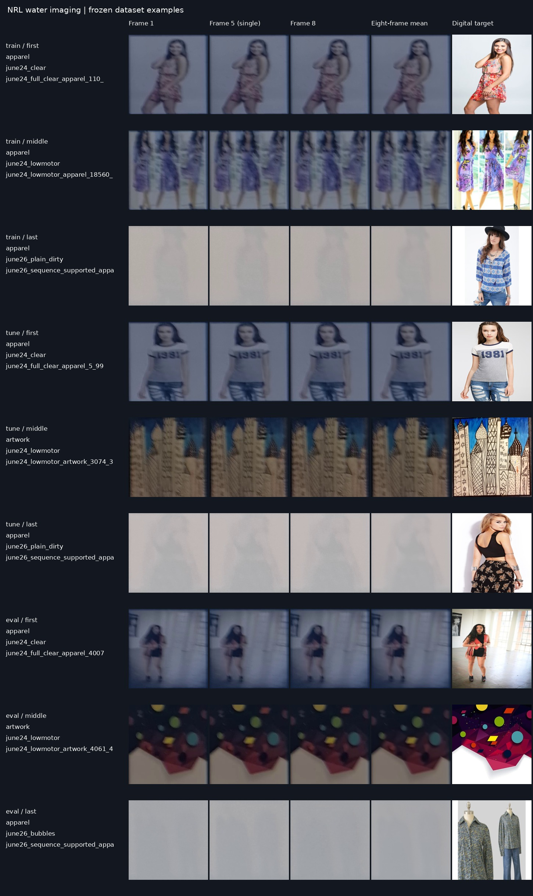

# Imaging through turbid, bubbly, and flowing water

**Code, frozen data splits, and selected models for computational imaging through water close to a telescope.**

This repository accompanies *Computational imaging through turbid, bubbly and flowing water near the telescope* by Alexander Ingold and colleagues. It provides a common interface for twelve selected restoration checkpoints, the original training implementations, and the evidence tables supporting the released models.

The study compares a single camera frame, an eight-frame arithmetic mean, and learned burst restoration. On the 329-record paired evaluation cohort, trained-mean and burst Restormer achieve 0.6756 and 0.6753 SSIM against the digital targets. The paired comparison does not establish an advantage of burst over trained mean. These scores describe the study's displayed-image acquisition and references.

## Downloads

| Resource | Location | Contents |
|---|---|---|
| Model weights | [Kaggle model weights](https://www.kaggle.com/datasets/alingold/turbid-water) | Ten primary restorers and two completed seed-4099 Restormer controls; original selection receipts and training initializers |
| Dataset | [Kaggle dataset](https://www.kaggle.com/datasets/alingold/turbid-water) | 3,342 paired intervals, the 3,475-record classification cohort, 128 natural-image crops, and 24 physical inputs |

Weights and data are hosted separately to keep this GitHub repository small. Download and extract each Kaggle package once. Pass the directories containing `model-index.json` and `data/`, respectively, to the commands below.

## Quick start

Use Python 3.10 or newer and a matching PyTorch/Torchvision installation. Install the remaining requirements from this directory:

```bash
python -m pip install -r requirements.txt
python scripts/verify_integrity.py /path/to/kaggle-model-weights
python scripts/verify_integrity.py /path/to/kaggle-dataset
python infer.py \
  --weights-root /path/to/kaggle-model-weights \
  --model restormer_RGB_mean_mixed_seed1337 \
  --input /path/to/image.png \
  --output outputs/restored.png
```

The command writes a display PNG and the unclipped float32 RGB prediction as `restored.npy`. CPU is the default. Add `--device cuda` for a compatible GPU. Existing outputs are protected from replacement.

For a still image, the loader repeats the image into eight input slots and limits the longest side to 256 pixels. Use `--max-side 0` to retain native image size, subject to available memory. A `.npy` input must contain eight uint8 RGB frames with shape `(8, H, W, 3)`; the released benchmark arrays use 256 by 256 pixels. Still-image repetition does not test temporal fusion. See [inference details](docs/INFERENCE.md).

## Models

| Family | Inputs trained independently | Parameters per model | Released seeds |
|---|---|---:|---|
| Compact EDVR | Single, mean, burst | 900,019 | 1337 |
| Joint-RGB Restormer, mixed training | Single, mean, burst | 26,135,716 | 1337; burst also 4099 |
| Joint-RGB Restormer, measured only | Burst | 26,135,716 | 1337, 4099 |
| Official width-32 NAFNet adaptation | Single, mean, burst | 17,117,955 | 1337 |

Every released fit completed 65,536 updates. Tuning SSIM selected each checkpoint. The [model index](model-index.json) records exact checkpoint hashes, selected updates, input modes, and training budgets. See the [model card](docs/MODEL_CARD.md) for architecture and selection details.

## Data and evaluation

| Cohort | Train | Tune | Evaluation |
|---|---:|---:|---:|
| Paired restoration intervals | 2,648 | 365 | 329 |
| Classification intervals | 2,758 | 372 | 345 |
| Distinct identities, each cohort | 580 | 76 | 72 |
| Natural-image crops | 96 | 16 | 16 diagnostic |



The classification cohort includes 133 additional category-only records. Use the paired manifest for restoration. Digital targets and clear-camera recordings answer different questions; the digital targets are not calibrated clear-camera ground truth. See the [data card](docs/DATA_CARD.md).

Run a cheap evaluation check before a full benchmark:

```bash
python evaluate.py --model restormer_RGB_mean_mixed_seed1337 \
  --weights-root /path/to/kaggle-model-weights \
  --data-root /path/to/kaggle-dataset \
  --output outputs/eval-smoke --limit 1
```

Omit `--limit` and choose a new output directory for all 329 evaluation records. Scores average recordings within acquisition condition, conditions within identity, then identities equally. [Reproduction instructions](docs/REPRODUCTION.md) cover the frozen training layouts and their assets. [Results](results/PRIMARY_RESTORATION.csv) record the paper's primary comparison; additional frozen NAFNet, two-seed, and UIEB evidence is included under `results/`.

## Citation and rights

Use [CITATION.cff](CITATION.cff) for the study title and authors. Publication identifiers have not been added because none were established in the supplied manuscript.

Project-authored source code in this repository uses the Apache License 2.0 in [LICENSE](LICENSE). Trained checkpoints, captured data, and displayed-image content retain their separate existing rights. Third-party code and natural images retain their own licenses and attribution. Read [RIGHTS_AND_ATTRIBUTION.md](RIGHTS_AND_ATTRIBUTION.md) before redistribution.
